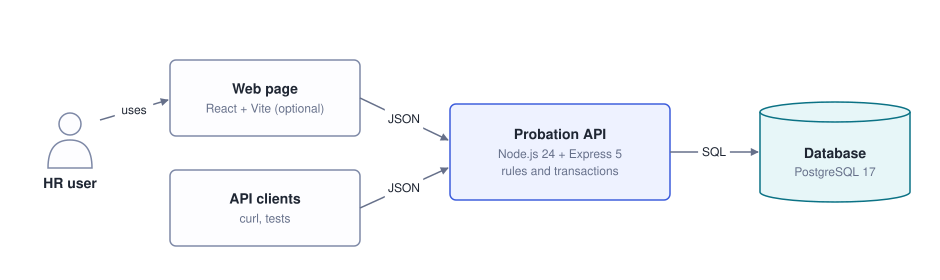

# Probation Review Tracker

[](https://github.com/apsariUdithara/Probation-Review-Tracker/actions/workflows/ci.yml)

A backend service that helps HR teams keep track of employees on probation: who is overdue, who is due soon, and every decision made along the way.

## Features

- **Add employees** with a join date and a probation length (1–6 months)
- **See what needs attention:** probations grouped as overdue, due within 7 days or due within 30 days
- **Confirm** an employee, at most once
- **Extend** a probation by 1–3 months with a reason, up to 6 months in total
- **Audit trail** of every change: who did what, and when
- **Company isolation:** each company only ever sees its own employees
- Optional **web page** that shows the list

**Built with** Node.js 24, TypeScript, Express 5, PostgreSQL 17, Zod and Vitest.

## Getting started

You need **Node.js 24** and **Docker**.

```sh
cp .env.example .env          # PowerShell: Copy-Item .env.example .env
docker compose up -d --wait   # start PostgreSQL
npm ci                        # install dependencies
npm run migrate               # create the database tables
npm run seed                  # add demo data (prints two company ids)
npm run dev                   # start the API on http://localhost:3000
```

To open the optional web page, keep the API running and in a second terminal run `npm ci --prefix web && npm run dev --prefix web`, then open http://localhost:5173.

### Useful commands

| Command                                    | What it does                                                       |
| ------------------------------------------ | ------------------------------------------------------------------ |
| `npm run dev`                              | Start the API and restart it when files change                     |
| `npm start`                                | Start the API without auto-restart                                 |
| `npm test`                                 | Run all tests (Docker must be running)                             |
| `npm run test:unit`                        | Run only the fast tests that don't need the database               |
| `npm run typecheck`                        | Check the TypeScript types                                         |
| `npm run migrate` / `npm run migrate:down` | Apply all migrations / undo the last one                           |
| `npm run seed`                             | Replace all data with the demo data                                |
| `npm run diagrams`                         | Regenerate the architecture diagrams                               |
| `npm run build --prefix web`               | Build the web page                                                 |
| `docker compose down`                      | Stop the database (keeps the data)                                 |
| `docker compose down -v`                   | Stop the database and delete all data, including the test database |

If port 5432 is already in use, stop the other PostgreSQL or change the port in `docker-compose.yml` and `.env`.

## API

| Endpoint                           | What it does                                           |
| ---------------------------------- | ------------------------------------------------------ |
| `POST /employees`                  | Add an employee: `{ name, joinDate, probationMonths }` |
| `GET /employees/:id`               | Get an employee and their extensions                   |
| `GET /probations?withinDays=30`    | List probations grouped by urgency                     |
| `POST /employees/:id/confirmation` | Confirm an employee                                    |
| `POST /employees/:id/extensions`   | Extend a probation: `{ months, reason }`               |
| `GET /employees/:id/audit-events`  | Get the audit trail                                    |

Every request needs two headers: `X-Company-Id` (the company) and `X-Actor-Id` (who is making the change).

For example, using a company created by `npm run seed`:

```sh
# Add an employee
curl -X POST localhost:3000/employees \
  -H 'X-Company-Id: 11111111-1111-4111-8111-111111111111' -H 'X-Actor-Id: hr@acme.example' \
  -H 'Content-Type: application/json' \
  -d '{"name":"Amaya Herath","joinDate":"2024-02-29","probationMonths":3}'

# List probations ending within 30 days
curl -H 'X-Company-Id: 11111111-1111-4111-8111-111111111111' -H 'X-Actor-Id: hr@acme.example' \
  'localhost:3000/probations?withinDays=30'
```

These are bash commands (macOS, Linux, or Git Bash on Windows).

> [!NOTE]
> These headers stand in for a login so the demo can act as different companies. They are not real authentication.

Errors always look like `{ "error": { "code", "message" } }`. The main ones are `400` (invalid input), `401` (missing headers), `404` (not found, or another company's employee), `409` (already confirmed) and `422` (over the 6-month limit).

## How it works



Requests pass through four layers: **middleware** identifies the company and user, **routes** validate the input, the **service** applies the business rules (every change runs in a database transaction), and the **repository** runs the SQL.

See **[docs/ARCHITECTURE.md](docs/ARCHITECTURE.md)** for diagrams of every flow, the full design decisions, all assumptions and the project structure.

## Design decisions

- **Plain SQL instead of an ORM.** The design relies on PostgreSQL features (generated columns, CHECK constraints, row locks), and with only 11 queries plain SQL keeps things simple. Prisma and Drizzle are compared in the architecture document.
- **The database calculates the end date** from the join date, so month ends and 29 February are handled correctly and extensions never drift.
- **Row locks and transactions** make sure an employee is confirmed only once, even if two people click at the same moment, and a rejected request changes nothing.
- **The database enforces the rules too:** totals of 1–6 months, and no record can link two companies, even if the application had a bug.
- **Another company's employee returns 404, not 403,** so their existence is never revealed.
- **"Today" is always the Sri Lankan date** (Asia/Colombo), whatever timezone the server runs in.

## Assumptions

- The end date is the anniversary: joining 15 January on 3 months ends 15 April.
- Overdue probations are always listed. You can look up to 365 days ahead; anything beyond 30 days appears as "due later".
- A confirmed employee can't be extended. Confirming early or late is allowed.

The full list is in [docs/ARCHITECTURE.md](docs/ARCHITECTURE.md#assumptions).

## Testing

168 automated tests: unit tests for the business rules and date logic, and integration tests that run against a real PostgreSQL database. They include the required edge cases:

| Edge case                               | Result                                   |
| --------------------------------------- | ---------------------------------------- |
| Probation ends today                    | Listed as due within 7 days, not overdue |
| Join date of 29 February                | 2024-02-29 + 3 months ends on 2024-05-29 |
| Extension over 6 months                 | Rejected, and nothing changes            |
| One company viewing another's employees | Not found on every endpoint              |

## What I would do next with more time

- Real authentication with roles (for example HR and manager)
- A "fail probation" outcome
- Email or Slack reminders when a probation is due
- Pagination and an OpenAPI specification

---
