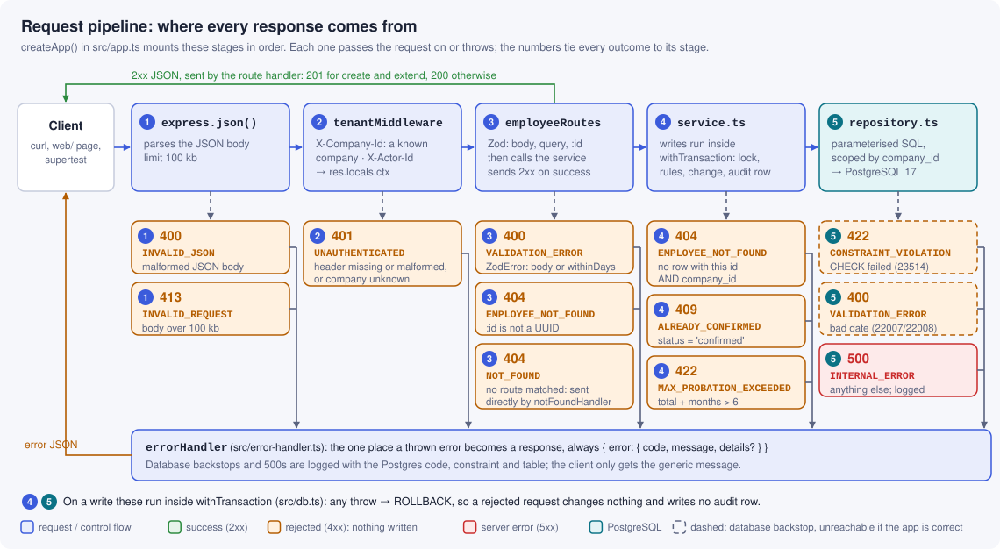
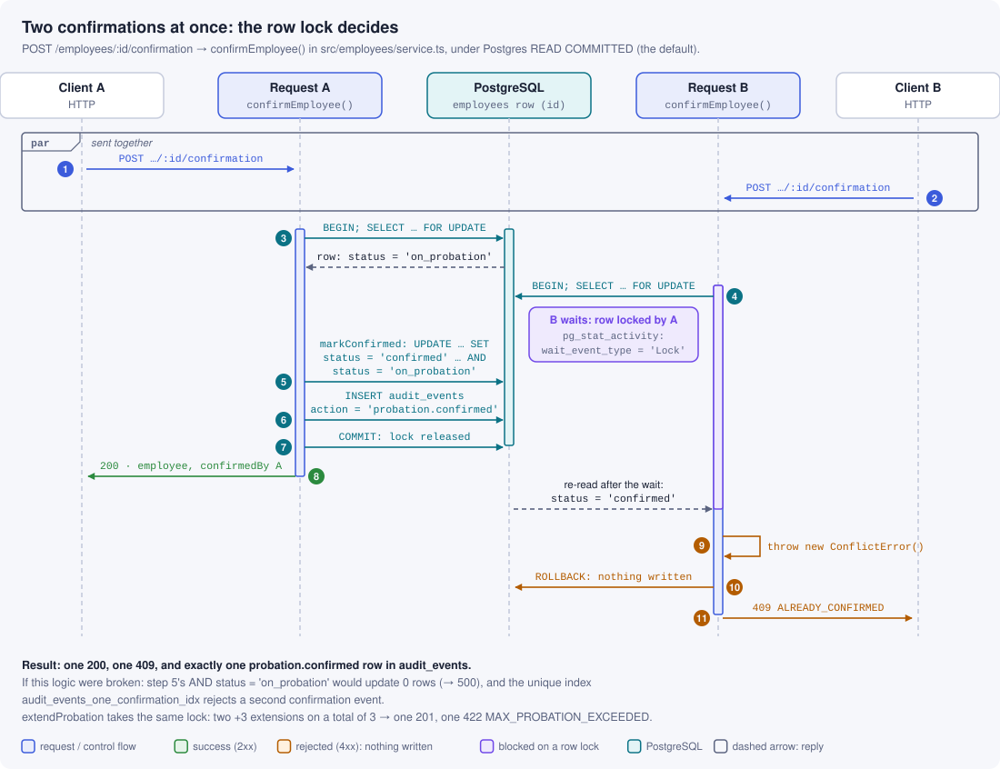
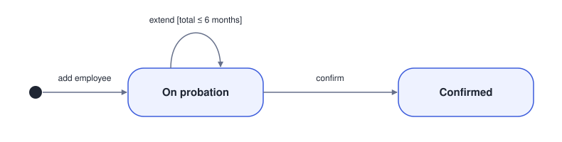
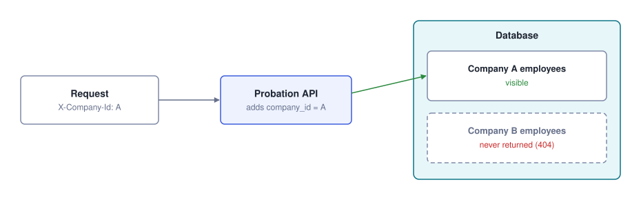

# Probation Review Tracker

A small backend service that helps an HR team track employees on probation. HR can add employees, see whose probation is overdue or ending soon, confirm employees and extend probations. Every confirmation and extension is recorded in an audit trail, and each company only ever sees its own employees.

Built with Node.js 24 + TypeScript, Express 5, PostgreSQL 17 (with migrations), Zod and Vitest.

## Requirements checklist

| Requirement | Where | Proven by |
|---|---|---|
| Add an employee (name, company, join date, probation months) | `POST /employees` | `test/integration/employees.test.ts`, `dates.test.ts` |
| List probations ending within N days, grouped overdue / ≤ 7 days / ≤ 30 days | `GET /probations?withinDays=N` | `test/integration/probations.test.ts` |
| Confirm an employee; never twice | `POST /employees/:id/confirmation` | `test/integration/lifecycle.test.ts` |
| Extend by 1–3 months with a reason; total ≤ 6 months | `POST /employees/:id/extensions` | `test/integration/lifecycle.test.ts` |
| Audit trail of every confirmation and extension: who, what, when | `GET /employees/:id/audit-events` | `test/integration/lifecycle.test.ts` |
| Company data kept separate, with a test proving it | Company filter on every query + composite foreign keys | `test/integration/isolation.test.ts` |
| Edge cases: ends today, 29 February join, extension over 6 months | | See [Testing](#testing) |
| PostgreSQL with migrations | `migrations/` (node-pg-migrate) | `npm run migrate` |
| Optional: a simple React page that shows the list | `web/` | `npm run dev --prefix web` |

## Quick start

**Prerequisites:** Node.js 24 (see `.nvmrc`) and Docker.

```sh
cp .env.example .env          # PowerShell: Copy-Item .env.example .env
docker compose up -d --wait   # Postgres 17 on port 5432, plus a separate probation_test database
npm ci
npm run migrate               # create the schema
npm run seed                  # made-up demo data; prints the two company ids
npm run dev                   # http://localhost:3000
```

Run the tests (Docker must be running):

```sh
npm test            # all 160 tests: unit + integration against the real test database
npm run test:unit   # pure unit tests only, no database needed
npm run typecheck   # tsc --noEmit
```

There is no build step: Node 24 runs the `.ts` files directly (type stripping) and `tsc` only checks types.

**Optional React page** that shows the grouped list. Keep the API running (`npm run dev`) and, in a second terminal:

```sh
npm ci --prefix web
npm run dev --prefix web      # http://localhost:5173
```

Pick a seeded company and a window (0–365 days). The page is read-only. Vite forwards `/api/*` to the API on port 3000, and the page sends the same demo headers as any other client. Because there is no companies endpoint, it lists the two companies created by `npm run seed`.

**Troubleshooting**

- *Port 5432 is already in use:* stop the other Postgres, or change the host port in `docker-compose.yml` and in both URLs in `.env`.
- *`probation_test` does not exist:* the init script only runs when the Docker volume is first created. Recreate it with `docker compose down -v` then `docker compose up -d --wait`.

## API

Every request needs two **demonstration headers**. They are not authentication (see [Security note](#security-note)):

| Header | Value |
|---|---|
| `X-Company-Id` | id of an existing company (the seed script prints two) |
| `X-Actor-Id` | who is making the change, 1–100 characters. It is recorded in the audit trail. |

Dates are `YYYY-MM-DD`. Timestamps are ISO-8601. Request bodies are strict: unknown fields such as `companyId` are rejected.

| Method and path | Purpose | Success |
|---|---|---|
| `POST /employees` | Add an employee: `{ name, joinDate, probationMonths }` (1–6) | 201 + `Location` |
| `GET /employees/:id` | One employee plus their extension history | 200 |
| `GET /probations?withinDays=N` | Unconfirmed probations grouped by urgency (N is 0–365, default 30) | 200 |
| `POST /employees/:id/confirmation` | Confirm. No body needed. | 200 |
| `POST /employees/:id/extensions` | Extend: `{ months, reason }` (1–3 months, reason 1–500 characters) | 201 |
| `GET /employees/:id/audit-events` | Audit trail, oldest first | 200 |

### Examples

After `npm run seed`, using the seeded company *Acme Lanka*:

```sh
H1='X-Company-Id: 11111111-1111-4111-8111-111111111111'
H2='X-Actor-Id: hr@acme.example'

curl -s -H "$H1" -H "$H2" 'localhost:3000/probations?withinDays=60'

curl -s -H "$H1" -H "$H2" -H 'Content-Type: application/json' \
  -d '{"name":"Amaya Herath","joinDate":"2024-02-29","probationMonths":3}' \
  localhost:3000/employees

curl -s -X POST -H "$H1" -H "$H2" localhost:3000/employees/<id>/confirmation

curl -s -H "$H1" -H "$H2" -H 'Content-Type: application/json' \
  -d '{"months":2,"reason":"Needs more time on the payroll module"}' \
  localhost:3000/employees/<id>/extensions

curl -s -H "$H1" -H "$H2" localhost:3000/employees/<id>/audit-events
```

PowerShell equivalent of the list call:

```powershell
$h = @{ 'X-Company-Id' = '11111111-1111-4111-8111-111111111111'; 'X-Actor-Id' = 'hr@acme.example' }
Invoke-RestMethod -Headers $h 'http://localhost:3000/probations?withinDays=60' | ConvertTo-Json -Depth 5
```

### The grouped list

```json
{
  "asOf": "2026-11-13",
  "withinDays": 30,
  "counts": { "overdue": 1, "dueWithin7Days": 2, "dueWithin30Days": 1, "dueLater": 0 },
  "overdue":         [{ "id": "…", "name": "Nimal Perera", "joinDate": "2026-08-09", "probationEndDate": "2026-11-09", "totalProbationMonths": 3, "daysUntilEnd": -4 }],
  "dueWithin7Days":  [ … ],
  "dueWithin30Days": [ … ],
  "dueLater":        [ ]
}
```

| `daysUntilEnd` | Group |
|---|---|
| below 0 | `overdue` (always listed, however old) |
| 0–7 | `dueWithin7Days` (ending **today** is due, not overdue) |
| 8–30 | `dueWithin30Days` |
| 31–N | `dueLater` (only when N > 30) |

All four arrays are always present. Each is sorted by end date, then name, then id.

### Errors

Every error has the same shape: `{ "error": { "code", "message", "details"? } }`. `details` lists the fields that failed validation.

| Status | Code | When |
|---|---|---|
| 400 | `VALIDATION_ERROR` | Invalid body, query or date (e.g. `2025-02-29`) |
| 400 | `INVALID_JSON` | The body is not valid JSON |
| 401 | `UNAUTHENTICATED` | Demo headers missing, malformed, or the company is unknown |
| 404 | `EMPLOYEE_NOT_FOUND` | No such employee, **or it belongs to another company** |
| 404 | `NOT_FOUND` | Unknown route |
| 409 | `ALREADY_CONFIRMED` | Confirming or extending an already confirmed employee |
| 422 | `MAX_PROBATION_EXCEEDED` | The extension would take the total over 6 months |
| 422 | `CONSTRAINT_VIOLATION` | A database rule rejected the write. This is a backstop and should be unreachable. |
| 500 | `INTERNAL_ERROR` | Unexpected. The details go to the server log, never to the client. |

## Architecture

Generated from [`scripts/gen-diagrams.ts`](scripts/gen-diagrams.ts) (`npm run diagrams`). The colours mean the same thing in every diagram.

**Where does each response come from?** The five stages in `createApp()`, and every status code each one can produce:

<picture>
  <source media="(prefers-color-scheme: dark)" srcset="docs/diagrams/request-pipeline-dark.svg">
  
</picture>

**What happens when two people confirm the same employee at once?**

<picture>
  <source media="(prefers-color-scheme: dark)" srcset="docs/diagrams/concurrent-confirm-dark.svg">
  
</picture>

**Which actions are allowed in which state?**

<picture>
  <source media="(prefers-color-scheme: dark)" srcset="docs/diagrams/employee-lifecycle-dark.svg">
  
</picture>

**How is one company's data kept from another?**

<picture>
  <source media="(prefers-color-scheme: dark)" srcset="docs/diagrams/company-isolation-dark.svg">
  
</picture>

## Design decisions

**Layers.** `routes` (validation, status codes) → `service` (use cases, transactions) → `repository` (SQL only). Pure business rules live in `src/domain/` and have no database or HTTP code. `createApp({ pool, clock })` builds the app without opening a port, so tests inject the test database and a fixed date.

**`pg` with hand-written SQL, no ORM.** The things that matter most here are transactions, row locks, the company filter on every query, and database constraints. All of them are visible in [`repository.ts`](src/employees/repository.ts), where every statement is parameterised. *Alternative:* Prisma or Drizzle. They are shorter for simple CRUD, but they hide exactly the parts a reviewer needs to check.

**The end date is calculated by Postgres, never by JavaScript.** `probation_end_date` is a generated column: `join_date + make_interval(months => total_probation_months)`. That means:

- *Month-end clamping:* 2025-08-31 + 6 → 2026-02-28, and in a leap year 2023-08-31 + 6 → 2024-02-29.
- *No chaining:* it is always recomputed from the join date and the current total. So 2025-11-30 with 3 months, extended by 1, ends on 2026-03-30, not 03-28.
- *Always consistent:* the stored date can never disagree with the total.
- *Alternative:* JavaScript `Date.setMonth`, which overflows (31 Jan + 1 month → 2 or 3 March).

**Dates stay strings.** `pg` would turn a `DATE` into a local-midnight JavaScript `Date`, which displays as the previous day in UTC for Sri Lanka (UTC+05:30). [`db.ts`](src/db.ts) returns them as the raw `YYYY-MM-DD` string instead. Input dates are validated with plain integer checks ([`calendar.ts`](src/domain/calendar.ts)), not `Date`, so `2025-02-29`, `2026-04-31` and year `0000` are rejected.

**"Today" comes from an injected clock in Asia/Colombo time.** It is passed into SQL as a parameter. `CURRENT_DATE` is never used, because it depends on the database server's timezone and can't be fixed in tests. *Alternative:* a per-company timezone (see next steps).

**Concurrency: row lock and audit row in the same transaction.** Confirm and extend both follow the same steps:

1. `SELECT … FOR UPDATE` locks the employee row.
2. Check the rules.
3. Write the change.
4. Write the audit row and commit.

A second simultaneous request waits for the lock, then reads the committed row and gets 409 or 422. Any error rolls back the whole transaction, so a rejected request leaves no trace. There are two more safety nets: the `UPDATE` only matches rows still `on_probation`, and a unique index allows at most one `probation.confirmed` event per employee. A test proves the lock is what produces the 409: it holds the lock from a second connection and waits, using `pg_stat_activity`, until the API request is actually blocked on it.

**The database enforces the rules too ("defence in depth").** CHECK constraints keep the total between 1 and 6, extensions between 1 and 3 months, and allow only valid statuses. The confirmed fields must be all set or all empty. Composite foreign keys `(company_id, employee_id) → employees(company_id, id)` mean an extension or audit row can never be attached to another company's employee, even if the application code had a bug.

**404, not 403, for another company's employee.** The response is identical to "doesn't exist", so a caller can't even learn that an id is in use. Malformed ids also return 404, never 400 or 500.

**N is 0–365, with a fourth `dueLater` group.** The brief defines three groups, the largest being "within 30 days", but doesn't cap N.

- Returning 400 for `withinDays=60` would look like a bug.
- Labelling a row 45 days away as "within 30 days" would be wrong.
- So rows 31–N days away get their own clearly named group.

**Status codes.** 400 means the request is malformed. 409 means the current state forbids the action (already confirmed). 422 means the request is valid but a business rule says no (over 6 months).

**Audit log vs extensions table.** `probation_extensions` holds typed, constrained business data. `audit_events` is a uniform who/what/when log for all three event types, with a JSON `details` column. The code only ever inserts audit rows; nothing updates or deletes them.

## Assumptions

The brief leaves these open. Each default is implemented as described and is easy to change.

| # | Question | Assumption |
|---|---|---|
| A1 | How does the API know the caller's company? There is no login. | The `X-Company-Id` demonstration header, not real authentication. The company never comes from the URL or body. |
| A2 | Is the end date the anniversary, or the day before? | The anniversary: 2026-01-15 + 3 months → 2026-04-15. Changing it would take one new migration that subtracts a day in the generated column. |
| A3 | Is N limited? Are overdue probations shown? | N is a whole number 0–365, default 30. Overdue probations are always shown, because an unconfirmed overdue probation still needs action. |
| A4 | Who is "who" in the audit trail? | The `X-Actor-Id` header, which is self-reported. |
| A5 | Can a confirmed employee be extended? | No → 409. |
| A6 | Can someone be confirmed early, or after the end date? | Yes, both. |
| A7 | Can an overdue probation be extended? | Yes. |
| A8 | Is a future join date allowed? | Yes. |
| A9 | Are confirmed employees in the list? | No. The list shows pending reviews only. |
| A10 | Initial probation length? | A whole number from 1 to 6 months. |
| A11 | Which timezone defines "today"? | Asia/Colombo (`APP_TIMEZONE`). |
| A12 | Are duplicate names allowed? | Yes. Employees are identified by id. |

## Security note

`X-Company-Id` and `X-Actor-Id` are **trusted as sent**, so any client can claim any company or name. They only model "the caller's company and identity are already known". In production they would come from a verified identity, such as a session, a JWT claim, or an API key mapped to a company and user. Only [`src/tenant.ts`](src/tenant.ts) would change.

Other safeguards in place:

- All SQL is parameterised.
- Request bodies are strict, with a 100 kb limit.
- 500 responses never include SQL, constraint names or stack traces.
- `.env` is git-ignored, and all data is made up.

## Testing

160 tests in total. Integration tests run through HTTP (supertest) or direct SQL against a **real Postgres** test database. There are no in-memory fakes, because those don't model dates and locks faithfully. The clock is fixed at **2026-11-13**.

| File | Covers |
|---|---|
| `test/unit/probation.test.ts` | Group boundaries (−1, 0, 7, 8, 30, 31) and the 6-month rule |
| `test/unit/calendar.test.ts` | Leap years (1900, 2000, 2100), month lengths, date validation |
| `test/unit/clock.test.ts` | The Colombo date changing at 18:30 UTC |
| `test/integration/schema.test.ts` | Database constraints, composite foreign keys, generated dates, one confirmation per employee |
| `test/integration/dates.test.ts` | 29 February, month-end clamping, invalid dates |
| `test/integration/employees.test.ts` | Create and get: shape, validation, 404s |
| `test/integration/probations.test.ts` | Grouping, the N window, sorting, `withinDays` validation |
| `test/integration/lifecycle.test.ts` | Confirm, extend, audit history, concurrency |
| `test/integration/isolation.test.ts` | Demo headers (401) and company isolation on every endpoint |
| `test/integration/http.test.ts` | Unknown routes, malformed JSON |

**Required edge cases:**

- **A probation that ends today** (`probations.test.ts`, *"is due within 7 days with daysUntilEnd 0, not overdue"*): joined 2026-08-13 with 3 months, so it ends on the fixed today. It is in `dueWithin7Days` with `daysUntilEnd: 0`, and the probation that ended yesterday is `overdue`.
- **A join date of 29 February** (`dates.test.ts`): 2024-02-29 + 3 months ends 2024-05-29, and `joinDate` comes back from both POST and GET as exactly `"2024-02-29"`.
- **An extension over the 6-month limit** (`lifecycle.test.ts`): 4 months, extended by 2 (total 6), then by 1 → 422 `MAX_PROBATION_EXCEEDED`. The total, end date, status, extension history and audit count are all unchanged.
- **One company cannot see another's employees** (`isolation.test.ts`): every employee endpoint returns 404 to the other company, the employee is missing from its list, and its attempts change nothing.

Test safety: the test setup refuses to run unless the database name ends in `_test`, then runs the same migration code as `npm run migrate`.

## Project structure

```
migrations/          the only schema definition (SQL, up + down)
scripts/             migrate.ts (the only migration runner), seed.ts, gen-diagrams.ts
src/
  server.ts          entry point: config → pool → app → listen
  app.ts             createApp({ pool, clock }): middleware and routes
  config.ts  db.ts  clock.ts  tenant.ts  errors.ts  error-handler.ts
  domain/            pure rules (probation.ts) and date validation (calendar.ts)
  employees/         routes.ts → service.ts → repository.ts
test/unit/           fast, no database
test/integration/    HTTP and SQL against the test database
web/                 optional React page (Vite): the grouped list
docs/                the implementation plan
```

The full plan, with the reasoning behind each decision, is in [docs/IMPLEMENTATION_PLAN.md](docs/IMPLEMENTATION_PLAN.md).

## What I would do next with more time

- **Real authentication:** JWT or API keys mapped to a company and user, with roles (HR vs manager).
- **Postgres Row-Level Security:** a second isolation layer inside the database itself.
- **Audit log hardening:** a trigger plus `REVOKE UPDATE, DELETE`, so even a code bug can't change history.
- **A per-company timezone,** instead of one `APP_TIMEZONE`.
- **A "fail probation" outcome:** a new status value, one migration, one route and one service function.
- **Pagination** for the list and the audit trail.
- **RFC 9457 problem-details errors and an OpenAPI spec.**
- **Reminders:** email or Slack when a probation enters the 7-day window.
- **Structured logging** with request ids.

## How I used AI tools

<!-- TODO (author): write this section yourself. -->

## Time spent

<!-- TODO (author): fill in. -->
