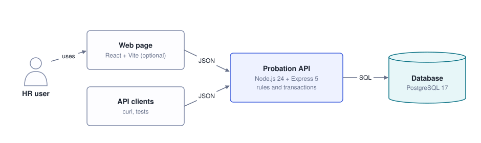
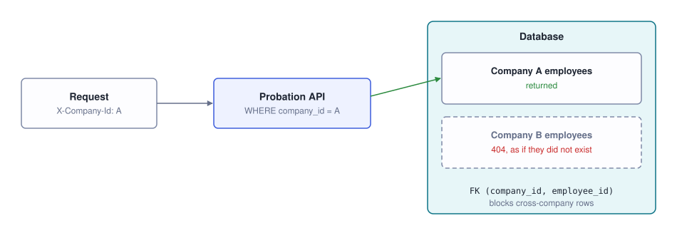
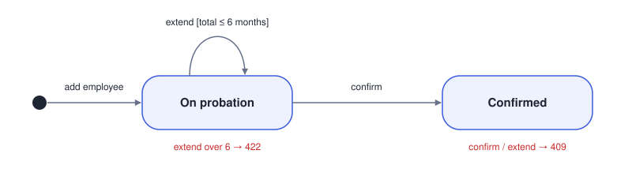
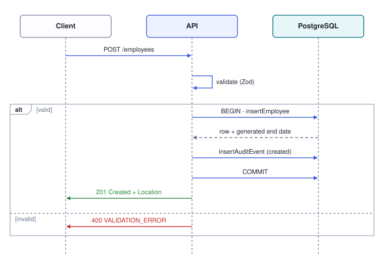
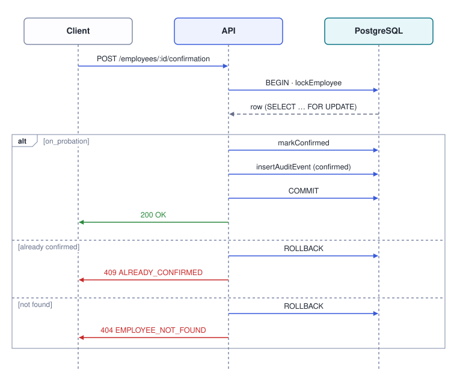
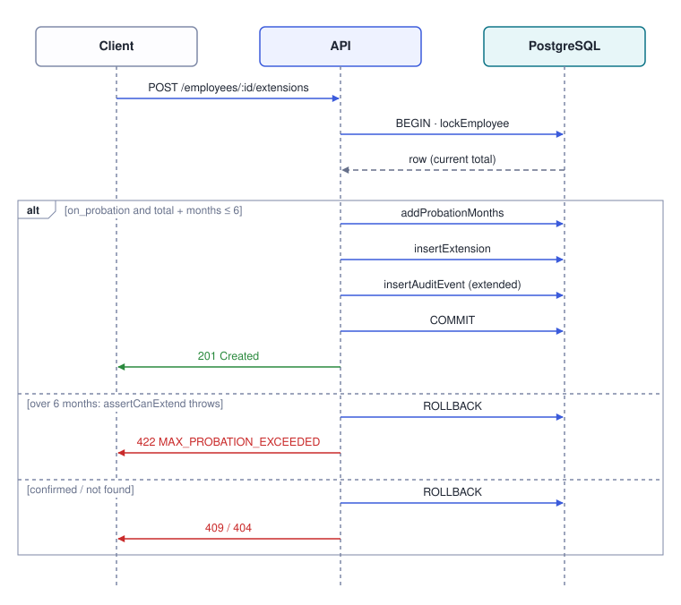
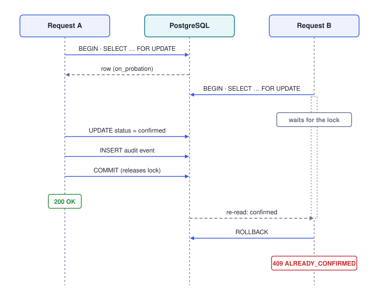
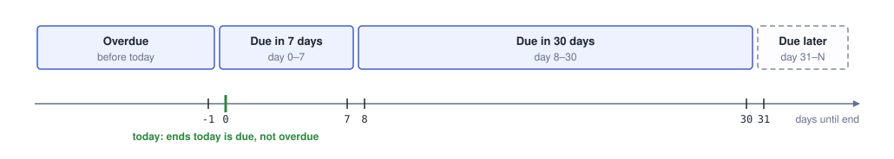

# Architecture

How the Probation Review Tracker is built, and why. For setup and usage, see the [README](../README.md).

- [Diagrams](#diagrams)
- [Design decisions](#design-decisions)
- [Assumptions](#assumptions)
- [Security](#security)
- [Project structure](#project-structure)

The diagrams are generated from [`scripts/gen-diagrams.ts`](../scripts/gen-diagrams.ts) with `npm run diagrams`.

## Diagrams

### System overview

All business logic lives in the API; the web page only displays data.



### API layers

Each layer has one job. Business rules are kept in a separate domain module with no database code, so they can be unit-tested.


### Where each response comes from

Each status code sits under the step that produces it. All errors leave through one error handler.


### Data model

The database enforces the limits as well, and calculates the end date itself.


### Company isolation

Enforced twice: by the query filter in the API, and by the foreign key in the database.



### Employee lifecycle

Overdue and due-soon are not states; they are calculated from the end date when the list is requested.



### Add an employee

The employee and its audit record are saved in one transaction.



### Confirm an employee

The row is locked first, so an employee can only be confirmed once.



### Extend a probation

An extension over 6 months is rejected before anything is written.



### Two confirms at the same time

The second request waits for the lock, then finds the employee already confirmed. Extensions are protected the same way.



### How the list is grouped

"Today" is the date in Asia/Colombo, whatever timezone the server runs in.



## Design decisions

**Plain SQL with `pg`, no ORM.**
- *Why:* the design relies on PostgreSQL features: a generated column, CHECK constraints, composite foreign keys, a partial unique index and row locks. Plain SQL keeps the migration as the single description of the schema.
- *Alternatives:* Prisma can't describe CHECK constraints or generated columns in its schema, needs raw queries for row locks, and returns dates as JavaScript `Date` objects. Drizzle could express almost all of it; with only 11 queries I chose fewer dependencies. Drizzle would be my first choice if the schema grew.

**PostgreSQL calculates the end date.**
- *Why:* a generated column (`join_date + total months`) is always recalculated from the join date, so extensions never chain: 2025-11-30 + 3 months, extended by 1, ends on 2026-03-30, not 03-28. Month ends are clamped correctly: 2025-08-31 + 6 months → 2026-02-28.
- *Alternative:* JavaScript `Date.setMonth`, which overflows: 31 January + 1 month gives early March.

**Dates stay as `YYYY-MM-DD` strings.**
- *Why:* converting a date to a JavaScript `Date` can shift it by a day across time zones. Input dates are checked with plain integer rules, so `2025-02-29` and `2026-04-31` are rejected.

**"Today" comes from an injected clock (Asia/Colombo).**
- *Why:* it is passed into SQL as a parameter, never `CURRENT_DATE`, so the result doesn't depend on the database server's timezone, and tests can fix the date.

**Row lock and audit record in one transaction.**
- *Why:* confirm and extend lock the employee row first (`SELECT … FOR UPDATE`). A second simultaneous request waits, then sees the updated row and is rejected. Any error rolls back everything, so a rejected request leaves no trace.
- *Safety nets:* the update only applies to employees still on probation, and a unique index allows at most one confirmation event per employee.

**The database enforces the rules too.**
- *Why:* CHECK constraints (total 1–6, extension 1–3, valid status) and composite foreign keys reject bad or cross-company data even if the application had a bug.

**404, not 403, for another company's employee.**
- *Why:* the response is identical to "does not exist", so a caller can't learn which ids are in use.

**A fourth `dueLater` group.**
- *Why:* the brief does not cap N. Rejecting `withinDays=60` would look like a bug, and labelling a row 45 days away "within 30 days" would be wrong.

**Status codes.** 400 means malformed input, 409 means the current state forbids the action, and 422 means the input is valid but a business rule says no.

## Assumptions

The brief leaves these open; each is easy to change.

| Question | Assumption |
|---|---|
| How does the API know the caller's company? | The `X-Company-Id` header (a stand-in for a login) |
| Who is "who" in the audit trail? | The `X-Actor-Id` header (self-reported) |
| Is the end date the anniversary or the day before? | The anniversary: 2026-01-15 + 3 months → 2026-04-15 |
| Range of N? Are overdue probations shown? | N is 0–365, default 30; overdue probations are always shown |
| Initial probation length? | 1–6 whole months |
| Can a confirmed employee be extended? | No (409) |
| Can someone be confirmed early or late? | Yes |
| Can an overdue probation be extended? | Yes |
| Are future join dates allowed? | Yes |
| Are confirmed employees in the list? | No; the list shows pending reviews only |
| Which timezone defines "today"? | Asia/Colombo (`APP_TIMEZONE`) |
| Are duplicate names allowed? | Yes; employees are identified by id |

## Security

- **The demo headers are not authentication.** Any client can claim any company or user. In production they would come from a verified identity (session, JWT or API key); only [`src/tenant.ts`](../src/tenant.ts) would change.
- All SQL is parameterised.
- Request bodies are validated strictly, with a 100 kb limit.
- Error responses never include SQL, constraint names or stack traces.
- `.env` is git-ignored, and all data is made up.

## Project structure

```
migrations/        database schema (SQL)
scripts/           migrate.ts, seed.ts, gen-diagrams.ts
src/
  server.ts        entry point
  app.ts           wires middleware and routes
  tenant.ts        reads the company and user headers
  error-handler.ts turns errors into JSON responses
  domain/          pure business rules and date validation
  employees/       routes.ts → service.ts → repository.ts
test/unit/         tests without a database
test/integration/  tests against the test database
web/               optional React page
docs/              this document, the diagrams and the implementation plan
```

The original plan, with the full reasoning, is in [IMPLEMENTATION_PLAN.md](IMPLEMENTATION_PLAN.md).
